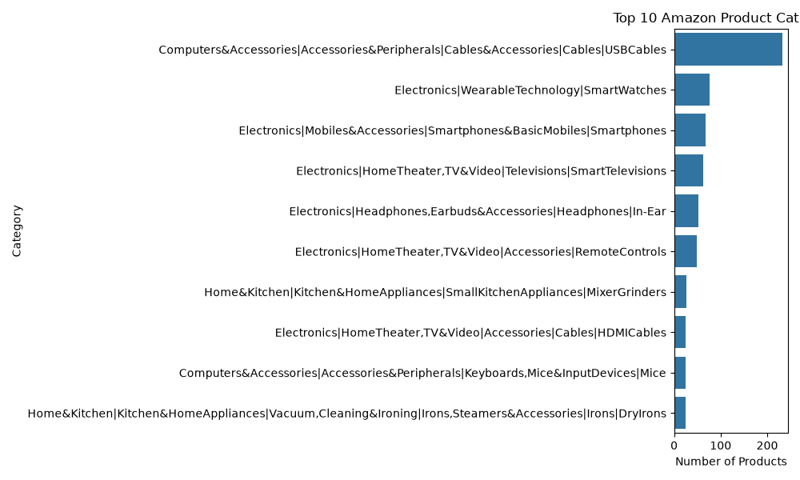
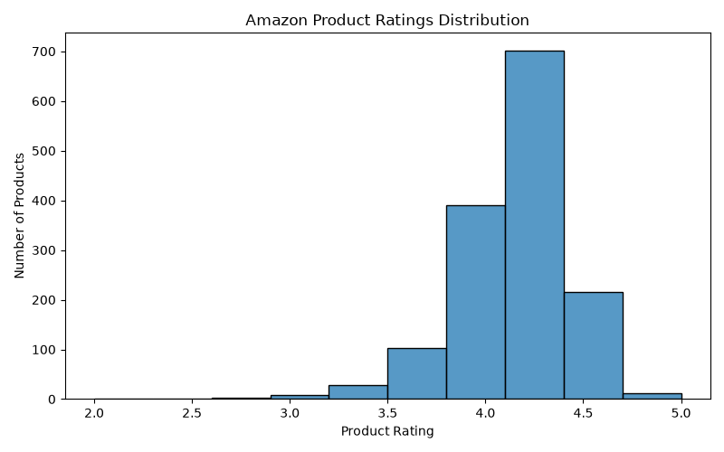
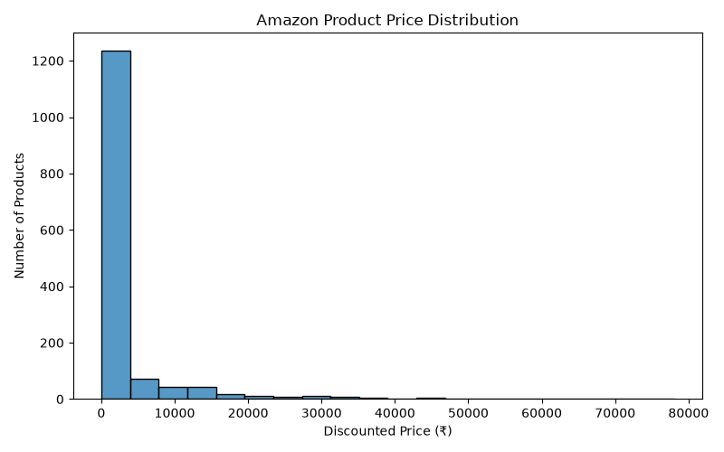
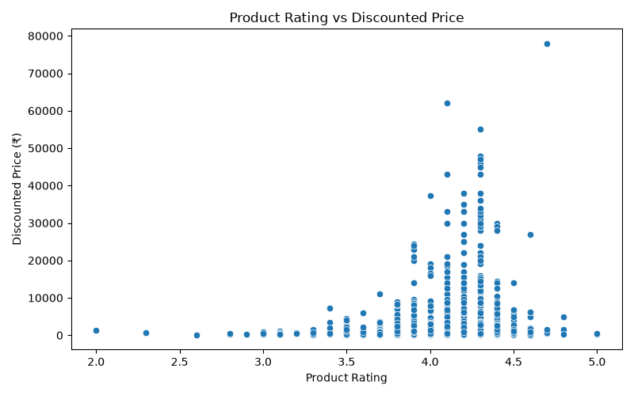

# amazon-sales-data-analysis
About the Project

Amazon Seller Analytics is a data analysis project focused on exploring Amazon product data and identifying useful patterns through Python-based analysis and visualization.

Project Objectives

- Analyze Amazon product data.
- Explore product ratings and pricing.
- Identify patterns and trends in the dataset.
- Create meaningful data visualizations.
- Present insights through charts and graphs.

Tools & Technologies

- Python
- Pandas
- Matplotlib
- Seaborn
- VS Code

Project Visualizations

This project includes four visualizations to explore and understand the dataset.

Key Learnings

- Data cleaning and handling using Pandas.
- Exploratory Data Analysis (EDA).
- Data visualization using Matplotlib and Seaborn.
- Understanding patterns in real-world datasets.

Conclusion

This project helped me gain practical experience in Python, data analysis, and visualization. It demonstrates how raw data can be transformed into meaningful visual insights.

Created by: Mamta Soni
### 1. Amazon Sales Visualization

### 2. Amazon Sales Visualization

### 3. Amazon Sales Visualization

### 4. Amazon Sales Visualization

